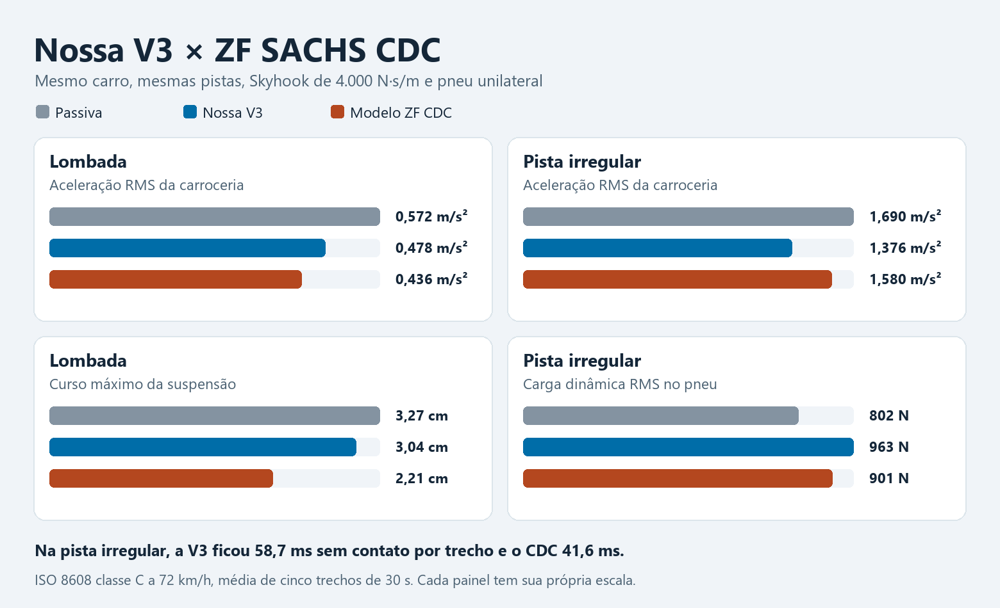

# Benchmark do amortecedor V3 com o ZF SACHS CDC

Simulamos o mesmo quarto de veículo em duas configurações. Uma usa o amortecedor V3 do projeto. A outra usa um modelo de amortecedor construído a partir das forças medidas em bancada em uma unidade ZF SACHS CDC. As duas usam o mesmo controle Skyhook do projeto, com ganho de **4.000 N·s/m**. A suspensão passiva serve de referência adicional.

## De onde vieram os dados do ZF

O artigo de Ding e colaboradores ensaiou um ZF SACHS CDC real e publicou as curvas-limite de força em função da velocidade do amortecedor. Aplicamos essas curvas à nossa simulação. Por exemplo, a +0,50 m/s, elas fornecem cerca de 631 a 2.587 N, enquanto o modelo V3 fornece 300 a 1.200 N. [Artigo e parâmetros utilizados](referencias/README.md)

Para a regulagem entre os extremos, usamos interpolação linear. Para o comando e a resposta do atuador, adotamos a eletrônica da V3 e a mesma constante de tempo de 15 ms no caso principal. As respostas do carro na pista foram calculadas com o nosso Skyhook. O software de fábrica da ZF e a dinâmica medida da sua válvula ficaram fora da campanha.

## Condições da simulação

- Quarto de veículo com massa suspensa de 250 kg, massa não suspensa de 40 kg, mola de 16.000 N/m e pneu de 200.000 N/m.
- Pneu unilateral. Se a roda perde contato, a força normal cai a zero até o contato voltar.
- Skyhook de 4.000 N·s/m, amostrado a cada 1 ms. Referência passiva de 1.500 N·s/m.
- Lombada de 5 cm com 0,7 s de duração e cinco trechos de 30 s de pista ISO 8608 classe C a 72 km/h. Usamos os perfis da campanha V3, disponíveis em [dados](dados).
- Integração RK4 com passo final de 0,125 ms. Os RMS usam a janela de 1 a 8 s na lombada e de 5 a 30 s na ISO. O tempo sem contato cobre o ensaio inteiro.

## Resultados

| Cenário | Métrica | Passiva | Nossa V3 | Modelo CDC |
|---|---|---:|---:|---:|
| Lombada | Aceleração RMS da carroceria | 0,572 m/s² | 0,478 m/s² | 0,436 m/s² |
| Lombada | Carga dinâmica RMS no pneu | 151,0 N | 128,3 N | 128,5 N |
| Lombada | Curso máximo da suspensão | 3,27 cm | 3,04 cm | 2,21 cm |
| ISO classe C | Aceleração RMS da carroceria | 1,690 m/s² | 1,376 m/s² | 1,580 m/s² |
| ISO classe C | Carga dinâmica RMS no pneu | 802 N | 963 N | 901 N |
| ISO classe C | Tempo sem contato por trecho | 3,8 ms | 58,7 ms | 41,6 ms |

Na lombada, a carroceria vibrou **8,8% menos com o CDC** do que com a V3, e o CDC usou menos curso de suspensão. As três configurações mantiveram contato com o chão. Na pista irregular, a carroceria vibrou **12,9% menos com a V3** do que com o CDC, mas a carga da roda oscilou **6,8% mais**. As duas semiativas perderam contato em todos os cinco trechos. A passiva perdeu contato em dois. Cada valor da pista ISO é a média dos cinco trechos.



[Baixar o vídeo da simulação lado a lado](comparacao.mp4?raw=true). O vídeo mostra a lombada e um recorte da semente 5 da pista irregular em câmera lenta. O gráfico acima resume a campanha inteira.

## Validação

1. **Reprodução da V3.** Com o pneu bilateral da campanha original, os desvios máximos frente ao Simulink foram de 0,26% na aceleração RMS e 0,19% na carga RMS. [Comparação com o Simulink](resultados/reproducao_simulink.csv)
2. **Convergência e consistência física.** Em 48 casos, reduzir o passo de 0,25 para 0,125 ms alterou os RMS em menos de 0,04% e o tempo sem contato em até 0,5 ms. Verificamos equilíbrio em pista plana, força normal não negativa, dissipação pelo amortecedor e balanço de energia. [Validação numérica](resultados/validacao.csv)
3. **Hipóteses sobre o CDC.** Avaliamos constantes de tempo de 7,5, 15 e 30 ms. Nos cinco trechos ISO, a V3 teve menor aceleração e maior carga dinâmica RMS em todos esses ajustes. Em um trecho, o CDC ultrapassou brevemente a velocidade-limite medida de 1,5 m/s. Congelar a força no limite da curva, em vez de continuar seu último segmento, alterou os RMS em menos de 0,04%. [Métricas por ensaio](resultados/metricas.csv) · [Resumo](resultados/resumo.csv)

## Reproduzir

Na raiz do repositório, execute com PowerShell 7. O simulador numérico usa C# e lê os perfis de pista compactados. Os resultados e as séries do vídeo são escritos em `Benchmark/resultados`.

```powershell
pwsh -NoProfile -File Benchmark/executar.ps1
```

Para gerar novamente o PNG e o MP4, use Python com Pillow, NumPy e FFmpeg com H.264. O script aceita o caminho do executável do FFmpeg e o diretório das fontes como opções.

```powershell
python Benchmark/gerar_midias.py
```

Os CSVs em `dados` guardam os perfis originais de 0,5 ms e a tabela usada na reprodução da V3. Os arquivos `resultados/sinais_*.csv.gz` trazem a pista, deslocamentos, aceleração e forças com amostragem de 1 ms para a animação. As métricas usam o passo completo de 0,125 ms.
