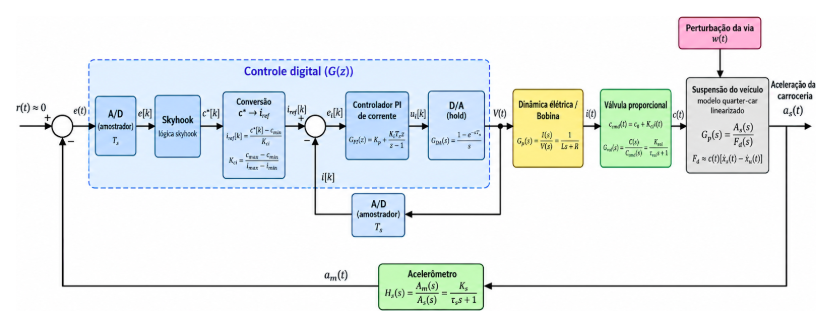

# Suspensão Semiativa — Amortecedor Inteligente

Projeto da disciplina **Controle 2 (Controle Digital)** — Engenharia de Computação, UFSCar.

Controle digital de uma suspensão semiativa, usando o **ZF CDC** como referência de mercado. A simulação vai ser feita em **MATLAB/Simulink**.

## Resumo do projeto

**O problema.** Uma suspensão precisa equilibrar duas coisas que brigam entre si:

- **conforto**, medido pela aceleração vertical da carroceria;
- **aderência**, medida pela deformação do pneu.

Na suspensão passiva o amortecimento é fixo, então ou ela é macia (confortável, mas segura menos a roda) ou é firme (segura a roda, mas passa mais vibração para o carro).

**A solução.** Uma suspensão **semiativa**: uma válvula proporcional muda a vazão de óleo dentro do amortecedor e, com isso, o coeficiente de amortecimento `c(t)`. Orifício pequeno deixa firme, orifício grande deixa macio. Um computador decide o valor de `c(t)` a cada 1 ms.

```
F_d = c(t) · v_rel        600 ≤ c(t) ≤ 2400 N·s/m
```

| | Passiva | Semiativa | Ativa |
|---|---|---|---|
| Amortecimento | fixo | variável | força de atuador |
| Energia | nenhuma | baixa (válvula) | alta |
| Custo | baixo | médio | alto |

A semiativa consegue ser melhor que a passiva sem a complexidade e o gasto de energia da ativa.

**Referência de mercado: ZF CDC.** Usa válvula proporcional (o solenoide controla a área do orifício), lógica skyhook no modo conforto, controle digital e acelerômetros na carroceria e na roda. Vem de série em carros como Audi A8, BMW Série 7, Porsche Cayenne e Mercedes Classe S. A ZF não publica a faixa de `c`, a corrente nem o tempo de resposta da válvula, então esses valores foram tirados de patente (Delphi), catálogo (HydraForce) e artigo (Ortiz-Espinoza 2014). Também simplificamos o problema: em vez do carro inteiro com os modos conforto e sport, usamos **1/4 de veículo e só o skyhook**, com foco no conflito conforto × aderência.

## Arquitetura



O controle é em **cascata** e roda num controlador digital com período de amostragem `T = 1 ms`:

- **Malha externa (skyhook):** o A/D lê o acelerômetro, a lógica skyhook decide o amortecimento pedido `c*[k]`, e a conversão transforma esse valor em corrente de referência `i_ref[k]`. Quando o amortecedor *ajuda* a frear a carroceria, ele endurece; quando *atrapalha*, fica o mais macio possível (600 N·s/m).
- **Malha interna (PI de corrente):** o PI compara `i_ref` com a corrente medida e calcula a tensão na bobina, que passa pelo D/A (ZOH). Essa malha faz a válvula obedecer.
- **Parte física (contínua):** bobina (circuito RL) → válvula proporcional (1ª ordem) → suspensão quarter-car de 2 GDL, com a perturbação da via `w(t)` entrando pelo pneu.

| | |
|---|---|
| Variável controlada | `a_s(t)`: aceleração vertical da carroceria [m/s²] |
| Variável de controle | `c(t)`: coeficiente de amortecimento [N·s/m], comandado pela corrente `i(t)` |
| Perturbação | `w(t)`: perfil da pista [m] |
| Referência | `r = 0` (regulador: rejeitar `w(t)`) |

## O que esperamos da simulação

1. **Implementar** no Simulink o modelo não linear completo: o produto `c(t)·v_rel`, as saturações de `c` e da corrente, a malha de corrente e a parte digital (amostradores e ZOH).
2. **Comparar** a suspensão passiva (`c` fixo) com a semiativa nas mesmas entradas:
   - **lombada** (teste transitório);
   - **pista irregular** gerada pela norma ISO 8608.
3. **Ajustar** o ganho do skyhook (`c_sky`) e os limites de operação, varrendo os valores e vendo onde o desempenho para de melhorar (superfícies de decisão do Díaz-Choque 2021).
4. **Validar** com três medidas:
   - **conforto:** aceleração RMS da carroceria, ponderada pela ISO 2631-1;
   - **aderência:** deformação do pneu;
   - **robustez:** variar o tempo de resposta da válvula e o período de amostragem.

**O que esperamos ver:** a semiativa reduzindo a aceleração da carroceria em relação à passiva, principalmente perto da ressonância da carroceria (~1,2 Hz), sem piorar a aderência. Para ter uma ordem de grandeza, o Díaz-Choque (2021) conseguiu com skyhook uma redução de **41 %** na aceleração RMS na pista ISO e de **30 %** na lombada. A expectativa é que perto da frequência da roda o controle quase não tenha efeito: em `√(k_t/m_u)` existe um ponto invariante, onde a aceleração da carroceria não depende de `c`.

## Parâmetros de partida (apresentação S1)

São os valores da apresentação S1 e vão servir de base para a primeira versão. **H** = hipótese nossa; **L** = literatura, patente ou catálogo.

| Bloco | Símbolo | Valor | Origem |
|---|---|---|---|
| Planta | m_s | 250 kg | H: 1/4 de carro compacto |
| Planta | m_u | 40 kg | L: Díaz-Choque 2021 |
| Planta | k_s | 16 000 N/m | H: carroceria a ~1,2 Hz (Gillespie) |
| Planta | k_t | 200 000 N/m | L: Jazar 2014 |
| Planta | c_eq | 1500 N·s/m | ζ = 0,375, dentro de 0,2–0,4 (Gillespie) |
| Válvula | c_mín / c_máx | 600 / 2400 N·s/m | L: patente Delphi (razão 4, faixa de 3 a 6) |
| Válvula | i | 0 a 1,5 A | L: HydraForce série 70 |
| Válvula | τ_val | 15 ms | L: Ortiz-Espinoza 2014 |
| Bobina | V_bat | 12 V | L: HydraForce |
| Bobina | R | 5,0 Ω | L: HydraForce série 70, a 20 °C |
| Bobina | L | 0,02 H | H: o catálogo não informa |
| PI de corrente | K_p | 10 V/A | L·ω_i, com ω_i = 500 rad/s |
| PI de corrente | K_i | 2500 V/(A·s) | K_p·R/L: o zero do PI cancela o polo da bobina |
| Digital | T | 1 ms | 10 a 30 vezes a banda da malha de corrente |

Conversão de amortecimento para corrente: 600 N·s/m → 0 A, 1500 N·s/m → 0,75 A, 2400 N·s/m → 1,5 A.

## Estrutura do repositório

```
├── modelo/
│   ├── montar_modelo.m    cria o suspensao_semiativa.slx bloco a bloco
│   ├── rodar_versao.m     simula uma versão e salva métricas e figuras
│   └── gerar_pista.m      perfis de pista (lombada, senoide, degrau)
├── versoes/     uma pasta por versão (parâmetros + resultados)
└── docs/        apresentações e figuras
```

## Como rodar

No MATLAB, com a pasta do repositório aberta:

```matlab
addpath('modelo')
montar_modelo          % cria modelo/suspensao_semiativa.slx (só na primeira vez)
rodar_versao('v1')     % simula e salva em versoes/v1/resultados/
```

## Como as versões vão ser organizadas

O **modelo do Simulink fica num lugar só** (`modelo/`). Cada versão ganha uma pasta com o que muda de uma para outra:

```
versoes/
└── v1/
    ├── parametros.m    todos os parâmetros da versão
    ├── README.md       o que mudou, por quê, e as métricas principais
    └── resultados/     figuras e dados (.csv / .mat pequenos)
```

Regras:

1. **Nenhum número digitado dentro dos blocos do Simulink.** Todos os ganhos usam nomes de variáveis (`m_s`, `Kp`, `c_sky`…) definidas no `parametros.m`. Assim, rodar uma versão é só carregar o arquivo dela e simular.
2. **Cada versão fechada vira uma tag no Git**, para dar para voltar ao modelo exatamente como estava:

   ```bash
   git tag -a v1 -m "resumo do que mudou"
   git push origin main --tags
   git checkout v1    # volta o repositório para a v1
   ```

3. O `.slx` é um arquivo binário, então o Git não mostra o que mudou dentro dele. Por isso a mensagem do commit e o README da versão precisam explicar a mudança.
4. Quando a primeira versão existir, este README ganha uma **tabela de versões** comparando parâmetros e resultados.

## Documentos

- [Apresentação S1](docs/Apresentacao_S1.pptx)

## Grupo

- João Luís Ramos Defendi Vignoli — RA 832962
- Murilo Oliva Mantovani — RA 834730
- Vinicius Matheus Blanco — RA 823357

**Professor:** Prof. Dr. Orides Morandin Junior

UFSCar · Engenharia de Computação · São Carlos, 2026

## Referências

1. WANG, J.; HUANG, Z.; HONG, H.; YU, S.; SHI, W.; ZHANG, X. Skyhook-Based Techniques for Vehicle Suspension Control: A Review of the State of the Art. *Machines*, v. 13, n. 8, art. 727, 2025. DOI: [10.3390/machines13080727](https://doi.org/10.3390/machines13080727).
2. DÍAZ-CHOQUE, C. S.; FÉLIX-HERRÁN, L. C.; RAMÍREZ-MENDOZA, R. A. Optimal Skyhook and Groundhook Control for Semiactive Suspension: A Comprehensive Methodology. *Shock and Vibration*, v. 2021, art. 8084343, 2021. DOI: [10.1155/2021/8084343](https://doi.org/10.1155/2021/8084343).
3. EDUARDO, G. P.; OHARA, P. P. H.; OLIVEIRA, R. J. G. *Suspensão semiativa com controle híbrido para valores diferentes de α*. TCC (Engenharia Mecânica), Universidade Presbiteriana Mackenzie, 2020.
4. ZF FRIEDRICHSHAFEN AG. *CDC: Smart Damping for More Driving Fun*. Disponível em: <https://www.zf.com/products/en/cars/stories/cdc.html>. · ZF AFTERMARKET. *SACHS CDC dampers*, 2012.
5. KUTSCHE, T.; RAULF, M. Optimised ride control for passenger cars and commercial vehicles. *ATZ Worldwide*, v. 103, 2001 (citado em [1]).
6. ZF FRIEDRICHSHAFEN AG. Patente EP 1 927 783 A2, 2006.
7. DELPHI TECHNOLOGIES. Patente US 6.390.252 B1.
8. HYDRAFORCE. *Proportional Coil Data* (série 70). Catálogo técnico.
9. ORTIZ-ESPINOZA, A. et al. Comparison of Semi-Active Suspension Controllers. In: *ADCONIP 2014*, p. 257–260.
10. STRECKER, Z. et al. Influence of MR damper response time on semiactive suspension control efficiency. *Meccanica*, v. 50, p. 1949–1959, 2015. DOI: [10.1007/s11012-015-0139-7](https://doi.org/10.1007/s11012-015-0139-7).
11. ISO 8608. *Mechanical vibration — Road surface profiles — Reporting of measured data.*
12. ISO 2631-1. *Mechanical vibration and shock — Evaluation of human exposure to whole-body vibration.*
13. KARNOPP, D.; CROSBY, M. J.; HARWOOD, R. A. Vibration Control Using Semi-Active Force Generators. *ASME Journal of Engineering for Industry*, v. 96, n. 2, p. 619–626, 1974. DOI: [10.1115/1.3438373](https://doi.org/10.1115/1.3438373).
14. GILLESPIE, T. D. *Fundamentals of Vehicle Dynamics*. SAE, 1992. · JAZAR, R. N. *Vehicle Dynamics: Theory and Application*. Springer, 2014 (citados em [3]).
15. TLX TECHNOLOGIES. *PWM Solenoid Theory*. · OGATA, K. *Discrete-Time Control Systems*.
