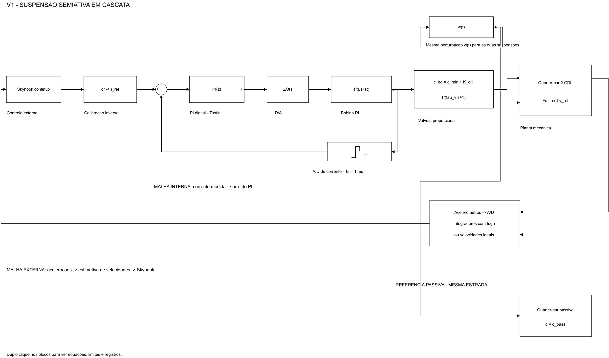
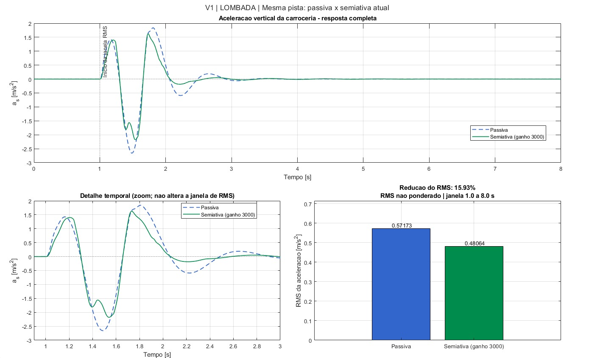
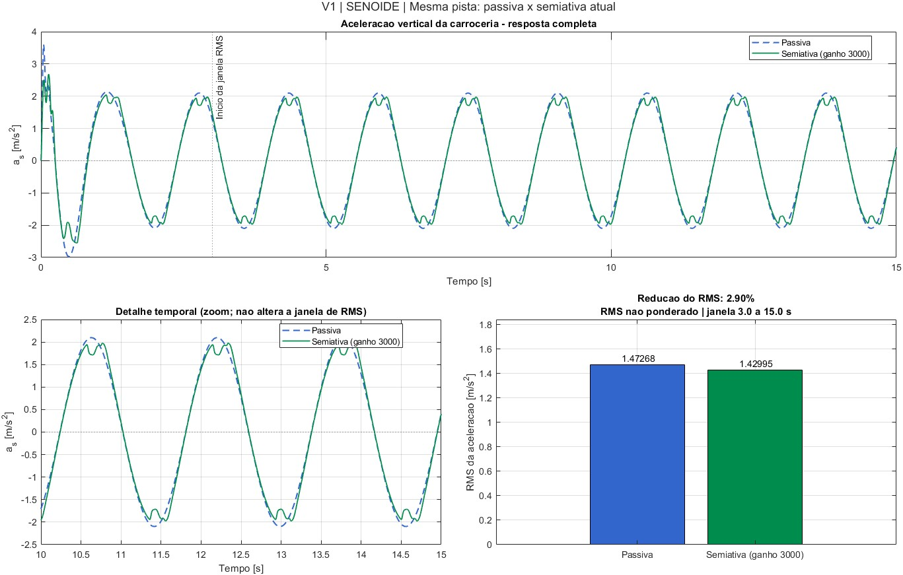
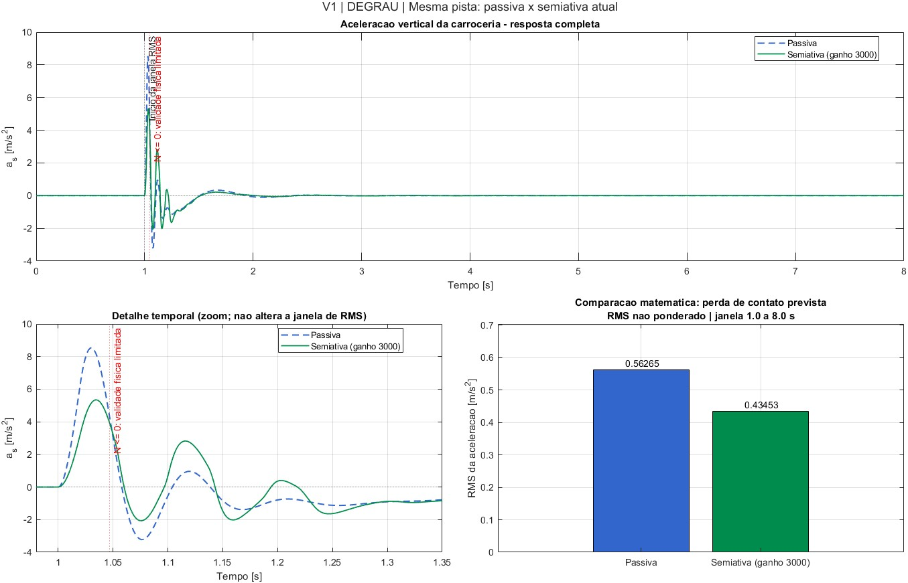

# v1 — primeira versão do modelo

Primeira versão da simulação no Simulink, com os **parâmetros da apresentação S1** (`parametros.m`). A ideia é ter a arquitetura completa rodando e comparar a semiativa com a passiva nas mesmas pistas.

## O que tem no modelo

- **Planta:** quarter-car de 2 GDL (espaço de estados), em coordenadas a partir do equilíbrio estático. A força normal no pneu é calculada separadamente: `N = (m_s + m_u)·g − k_t·(z_u − w)`.
- **Sensores:** dois acelerômetros (carroceria e roda) → A/D → integrador com fuga de 0,1 Hz (digital) para estimar as velocidades. Com `usar_sensores = 0`, o skyhook usa as velocidades exatas, para comparação.
- **Malha externa:** skyhook clássico, `c* = sat(c_sky·v_s/v_rel)` quando o amortecedor ajuda a frear a carroceria e `c* = c_mín` quando atrapalha. Depois a conversão `i_ref = (c* − c_mín)/K_ci`, limitada entre 0 e 1,5 A.
- **Malha interna:** PI de corrente discreto (Tustin, `T = 1 ms`), com saída limitada entre 0 e 12 V e anti-windup por *clamping*. Um bloco ZOH mantém a tensão constante entre as amostras.
- **Atuador:** bobina RL → válvula de 1ª ordem (`τ = 15 ms`), com `c` limitado entre 600 e 2400 N·s/m.
- **Passiva:** a mesma planta com `c = 1500 N·s/m` fixo, simulada junto para comparar.
- **Solver:** passo fixo `ode4` com `dt = 0,5 ms`.



## Decisões desta versão

- O limite de corrente e de amortecimento fica nos **blocos de saturação** (saída do PI e mapa da válvula), e não cortando os estados à força.
- **Sem limitador de taxa** no `c*`: ele não está no diagrama da S1 e, com a válvula de 15 ms, quase não teria efeito.
- O **degrau** de 3 cm é uma **rampa de 20 ms** para suavizar o salto de força. No pneu puramente elástico desta versão, um degrau ideal produziria um salto finito `k_t·altura`, e não força infinita.
- A pista ISO 8608 e a ponderação ISO 2631 ficam para as próximas versões.

## Como rodar

O jeito mais simples: abra `SIMULAR_V1.m` (na raiz do repositório) e clique em **Run**. Escolha a pista (lombada, senoide ou degrau) e ele abre o diagrama e a animação passiva x semiativa.

Para rodar as três pistas de uma vez, com gráficos e validação:

```matlab
[T,dados] = main;              % três pistas + animação da lombada
[T,dados] = main('v1',false);  % sem abrir a animação
animar_suspensao(dados(2));    % 1 = lombada, 2 = senoide, 3 = degrau
```

O `main` reconstrói o `.slx`. Se você editou o modelo na mão, salve uma cópia antes.

Passo a passo, se precisar rodar só uma parte:

```matlab
addpath('modelo','visualizacao','testes')
montar_modelo                               % cria modelo/suspensao_semiativa.slx
[T,dados] = rodar_versao('v1');             % simula e salva em resultados/
validar_v1(dados);                          % testes automáticos
plotar_comparacao_aceleracoes('v1',false);  % refaz os JPEGs dos resultados
```

Para mexer no modelo na mão: `run('versoes/v1/parametros.m')`, abrir o `.slx` e apertar *Run*. A pista usada é a do `pista_tipo` no fim do `parametros.m`.

Para ver a animação de novo sem simular (o `.mat` é gerado pelo `rodar_versao` e não vai para o Git):

```matlab
addpath('visualizacao');
load('versoes/v1/resultados/dados_simulacao.mat','dados');
animar_suspensao(dados(1));
```

## Resultados

Executado em **MATLAB R2024b**. RMS integrado no tempo (trapézios), sem ponderação ISO, usando `t_metrica` da pista: desde 1 s na lombada/degrau e desde 3 s na senoide. Os números completos e demais métricas ficam em `resultados/metricas.csv`.

| Pista | RMS a_s passiva [m/s²] | RMS a_s semiativa [m/s²] | Melhora | RMS da carga dinâmica no pneu, passiva / semi [N] |
|---|---|---|---|---|
| Lombada 5 cm | 0,57173 | 0,48064 | 15,93% | 151,00 / 128,29 |
| Senoide 10 cm, 4 rad/s | 1,47268 | 1,42995 | 2,90% | 414,16 / 403,43 |
| Degrau 3 cm (rampa 20 ms) | 0,56265 | 0,43453 | 22,77%* | 248,16 / 321,00* |

A carga dinâmica é o RMS de `N(t) − (m_s + m_u)·g`, nas mesmas janelas, e não a força normal total. O peso estático do quarter-car é 2844,9 N.

**\* Limitação física no degrau:** a semiativa chega a `N_min ≈ −484,95 N`, enquanto a passiva mantém `N_min ≈ 707,84 N`. A força normal negativa indicaria separação pneu-pista, que o modelo bilateral não representa. Portanto, a redução de RMS nesse cenário é um resultado matemático do modelo linear e não comprova desempenho físico após a perda de contato. A carga dinâmica e o curso também pioram nesse cenário; os resultados foram mantidos.

### Lombada



A semiativa diminui principalmente o maior pico negativo (de −2,65 para −2,2 m/s²) e a oscilação que sobra depois da lombada (perto de 2,2 s), quando a carroceria balança sozinha. É aí que o skyhook mais ajuda. A melhora de 15,9 % ainda fica abaixo dos 30 % do Díaz-Choque (2021), mas o `c_sky` ainda não foi ajustado.

### Senoide



A senoide de 4 rad/s (≈ 0,64 Hz) fica abaixo da ressonância da carroceria (~1,2 Hz). Nessa faixa a mola é quem mais define o movimento e o amortecedor tem pouco efeito, por isso a melhora é pequena (2,9 %). As pequenas ondulações perto dos picos aparecem quando o skyhook troca entre macio e firme.

### Degrau



É a maior redução de RMS e a semiativa também corta o primeiro pico (de 8,5 para 5,3 m/s²). Por outro lado, logo depois a semiativa oscila mais que a passiva (perto de 1,12 s) e o modelo marca força normal ≤ 0 por volta de 1,05 s. Isso mostra o conflito conforto × aderência: melhorar a aceleração da carroceria não adianta se a roda perde contato com a pista. Por isso o resultado do degrau só vai ser comparado depois de olhar a carga no pneu.

## Validação

O `testes/validar_v1.m` conferiu, nas três pistas: equações das duas massas, sinal das forças, amortecedor só dissipando energia, limites de amortecimento/corrente/tensão, ZOH, skyhook, estimador de velocidades, bobina e válvula contra a solução analítica, PI Tustin e anti-windup, e convergência com o passo pela metade. A passiva também foi comparada com uma integração RK4 feita à parte: erro máximo abaixo de `1,1e-14`.

Relatórios em `resultados/validacao.csv` e `resultados/validacao.txt`. Isso confere a implementação numérica, não valida os parâmetros contra um amortecedor real.

## Arquivos

| Arquivo | O que é |
|---|---|
| `parametros.m` | todos os parâmetros da v1 |
| `../../modelo/suspensao_semiativa.slx` | modelo do Simulink (gerado pelo `montar_modelo.m`) |
| `resultados/v1_{lombada,senoide,degrau}.jpeg` | gráficos de aceleração mostrados acima |
| `resultados/v1_{lombada,senoide,degrau}.png` | painel com 12 sinais por pista (curso, pneu, tensão, potência…) |
| `resultados/metricas.csv` | métricas das três pistas |
| `resultados/validacao.csv`, `validacao.txt` | resultado dos testes |
| `resultados/diagrama_v1.png` | diagrama do modelo |
| `resultados/animacao_v1.png` | quadro da animação |
| `APRESENTACAO_V1.md` | notas para explicar o diagrama na apresentação |

Scripts (pastas da raiz):

- `main.m` e `SIMULAR_V1.m`: rodam tudo a partir da raiz.
- `modelo/`: `montar_modelo.m` e `organizar_diagrama.m` (montam e organizam o `.slx`), `rodar_versao.m`, `simular_cenario.m`, `gerar_pista.m`, `coletar_sinais.m`, `metricas_suspensao.m` e `plotar_resultados.m`.
- `visualizacao/`: `plotar_comparacao_aceleracoes.m` (gráficos acima), `animar_suspensao.m` (animação com reproduzir/pausar/reiniciar e aviso quando `N ≤ 0`) e `exportar_videos_v1.m`.
- `testes/validar_v1.m`.

## Observações

- O RMS ainda **não é ponderado** pela ISO 2631.
- Os valores da bobina e do PI (L, Kp, Ki) são hipóteses nossas, porque o catálogo não informa a indutância.
- Se a força normal ficar ≤ 0, o pneu sairia do chão. O modelo não simula essa separação e o `rodar_versao` mostra um aviso.
- O limite de 1,5 A vale para a referência; a corrente da bobina não é cortada. Na lombada ela passa do limite por cerca de 0,000145 A, sem efeito, porque o amortecimento continua limitado pela saturação da válvula.
- `ω_i = Kp/L = 500 rad/s` equivale a uma banda de ~80 Hz para a malha de corrente, contra 1 kHz de amostragem. É um valor de projeto, não medido em hardware.
- Na animação, a estrada anda a uma velocidade só de desenho (`visual.velocidade_mapa`); as pistas da v1 são definidas no tempo e não dependem da velocidade do carro. A escala é a mesma nos dois painéis.
- Em relação ao commit `4f6115f`, os parâmetros, as pistas e o skyhook não mudaram. Só o cálculo do RMS passou de média das amostras para integral no tempo, o que muda as últimas casas decimais.
