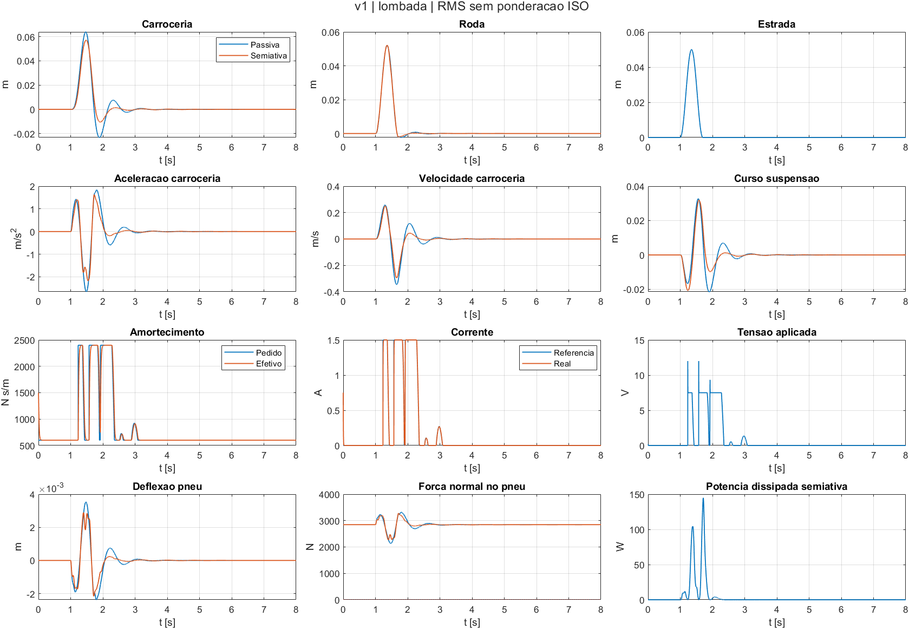
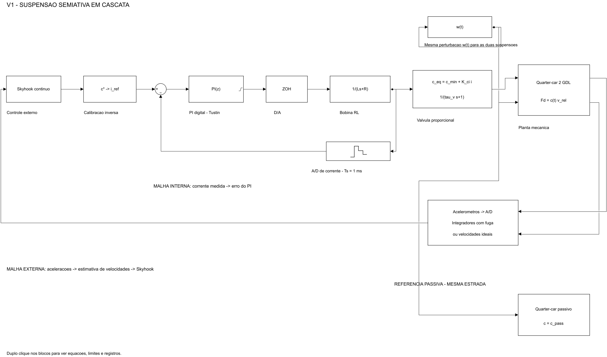

# v1 — primeira versão do modelo

Primeira versão da simulação no Simulink, com os **parâmetros da apresentação S1** (`parametros.m`). A ideia é ter a arquitetura completa rodando e comparar a semiativa com a passiva nas mesmas pistas.

## O que tem no modelo

- **Planta:** quarter-car de 2 GDL (espaço de estados), em coordenadas a partir do equilíbrio estático. A força normal no pneu é calculada separadamente: `N = (m_s + m_u)·g − k_t·(z_u − w)`.
- **Sensores:** dois acelerômetros (carroceria e roda) → A/D → integrador com fuga de 0,1 Hz (digital) para estimar as velocidades. Com `usar_sensores = 0`, o skyhook usa as velocidades exatas, para comparação.
- **Malha externa:** skyhook clássico, `c* = sat(c_sky·v_s/v_rel)` quando o amortecedor ajuda a frear a carroceria e `c* = c_mín` quando atrapalha. Depois a conversão `i_ref = (c* − c_mín)/K_ci`, limitada entre 0 e 1,5 A.
- **Malha interna:** PI de corrente discreto (Tustin, `T = 1 ms`), com saída limitada entre 0 e 12 V e anti-windup por *clamping*. Um bloco ZOH explícito mantém a tensão entre amostras, equivalente à retenção que a saída discreta do PI já realizava.
- **Atuador:** bobina RL → válvula de 1ª ordem (`τ = 15 ms`), com `c` limitado entre 600 e 2400 N·s/m.
- **Passiva:** a mesma planta com `c = 1500 N·s/m` fixo, simulada junto para comparar.
- **Solver:** passo fixo `ode4` com `dt = 0,5 ms`.

## Decisões desta versão

- O limite de corrente e de amortecimento fica nos **blocos de saturação** (saída do PI e mapa da válvula), e não cortando os estados à força.
- **Sem limitador de taxa** no `c*`: ele não está no diagrama da S1 e, com a válvula de 15 ms, quase não teria efeito.
- O **degrau** de 3 cm é uma **rampa de 20 ms** para suavizar o salto de força. No pneu puramente elástico desta versão, um degrau ideal produziria um salto finito `k_t·altura`, e não força infinita.
- A pista ISO 8608 e a ponderação ISO 2631 ficam para as próximas versões.

## Como rodar

No MATLAB, com a pasta do repositório aberta:

```matlab
[T,dados] = main;      % modelo, tres pistas, graficos, validacao e animacao
```

Sem abrir a animação:

```matlab
[T,dados] = main('v1',false);
animar_suspensao(dados(2)); % senoide; 1=lombada, 3=degrau
```

Os comandos originais continuam disponíveis:

```matlab
addpath('modelo','visualizacao','testes')
montar_modelo
[T,dados] = rodar_versao('v1');
validar_v1(dados);
animar_suspensao(dados(1));
```

Para mexer no modelo na mão: `run('versoes/v1/parametros.m')`, abrir o `.slx` e apertar *Run*. A pista usada é a do `pista_tipo` no fim do `parametros.m`.

## Resultados

Executado em **MATLAB 24.2.0.2712019 (R2024b)**. RMS integrado no tempo, sem ponderação ISO, usando `t_metrica` da pista: desde 1 s na lombada/degrau e desde 3 s na senoide. Os números completos e demais métricas ficam em `resultados/metricas.csv`.

| Pista | RMS a_s passiva [m/s²] | RMS a_s semiativa [m/s²] | Melhora | RMS da carga dinâmica no pneu, passiva / semi [N] |
|---|---|---|---|---|
| Lombada 5 cm | 0,57173 | 0,48064 | 15,93% | 151,00 / 128,29 |
| Senoide 10 cm, 4 rad/s | 1,47268 | 1,42995 | 2,90% | 414,16 / 403,43 |
| Degrau 3 cm (rampa 20 ms) | 0,56265 | 0,43453 | 22,77%* | 248,16 / 321,00* |

A coluna de carga é calculada a partir de `resultados/metricas.csv`, campos
`rms_carga_pneu_passivo_N` e `rms_carga_pneu_semi_N`. É o RMS de
`N(t) - (m_s + m_u)*g`, nas mesmas janelas indicadas acima, e não a força
normal total média. O peso estático do quarter-car é 2844,9 N.

**\* Limitação física no degrau:** a semiativa chega a `N_min ≈ −484,95 N`, enquanto a passiva mantém `N_min ≈ 707,84 N`. A força normal negativa indicaria separação pneu-pista, que o modelo bilateral não representa. Portanto, a redução de RMS nesse cenário é um resultado matemático do modelo linear e não comprova desempenho físico após a perda de contato. A carga dinâmica e o curso também pioram nesse cenário; os resultados foram mantidos.





### Lombada


A semiativa diminui principalmente o maior pico negativo (de −2,65 para −2,2 m/s²) e a oscilação que sobra depois da lombada (perto de 2,2 s), quando a carroceria balança sozinha. É aí que o skyhook mais ajuda. A melhora de 15,9 % ainda fica abaixo dos 30 % do Díaz-Choque (2021), mas o `c_sky` ainda não foi ajustado.

### Senoide


A senoide de 4 rad/s (≈ 0,64 Hz) fica abaixo da ressonância da carroceria (~1,2 Hz). Nessa faixa a mola é quem mais define o movimento e o amortecedor tem pouco efeito, por isso a melhora é pequena (2,9 %). As pequenas ondulações perto dos picos aparecem quando o skyhook troca entre macio e firme.

### Degrau


É a maior redução de RMS e a semiativa também corta o primeiro pico (de 8,5 para 5,3 m/s²). Por outro lado, logo depois a semiativa oscila mais que a passiva (perto de 1,12 s) e o modelo marca força normal ≤ 0 por volta de 1,05 s. Isso mostra o conflito conforto × aderência: melhorar a aceleração da carroceria não adianta se a roda perde contato com a pista. Por isso o resultado do degrau só vai ser comparado depois de olhar a carga no pneu.

## Implementação acrescentada à v1

### Reproduzir os gráficos publicados

Os JPEGs `v1_lombada.jpeg`, `v1_senoide.jpeg` e `v1_degrau.jpeg` usam
resposta completa, zoom e barras de RMS. O código desse formato está em
`visualizacao/plotar_comparacao_aceleracoes.m`, separado do painel de 12
sinais de `modelo/plotar_resultados.m`, chamado por `rodar_versao.m`.

```matlab
addpath('modelo','visualizacao')
[T,dados] = rodar_versao('v1'); % também regenera dados_simulacao.mat
plotar_comparacao_aceleracoes('v1',false);
```

A função grava os JPEGs em `versoes/v1/resultados/` e cópias PNG e FIG em
`resultados/comparacao_aceleracoes/`. Os dados brutos e FIGs são regeneráveis
e ficam fora do controle de versão. Os PNGs de 12 painéis continuam disponíveis.

### Arquivos da implementação

- `main.m`: execução completa a partir da raiz do repositório.
- `modelo/organizar_diagrama.m`: diagrama clássico completo, com as malhas de corrente e mecânica, o estimador e o ramo passivo visíveis. O agrupamento em subsistemas é virtual e preserva as equações.
- `modelo/coletar_sinais.m`: coleta dos sinais reais do Simulink; sinais digitais mantidos por amostra anterior ao montar a base temporal comum.
- `modelo/metricas_suspensao.m` e `modelo/plotar_resultados.m`: métricas e 12 gráficos por cenário, incluindo curso, pneu, tensão e potência dissipada.
- `visualizacao/plotar_comparacao_aceleracoes.m`: fonte dos gráficos comparativos de aceleração publicados nesta versão.
- `visualizacao/animar_suspensao.m`: animação 2D passiva × semiativa, com roda, carroceria, mola, amortecedor e estrada; reproduzir, pausar, reiniciar e velocidade. Um aviso aparece quando `N<=0`.
- `testes/validar_v1.m`: verificações automatizadas sobre os três cenários e subsistemas isolados.
- Modelo editável `modelo/suspensao_semiativa.slx`, CSV, PNG e relatório de validação prontos.

### Fechamento da tag v1

A tag `v1` deve apontar para um commit que já inclua o `.slx`, os parâmetros,
os scripts de geração e de gráficos e as métricas. Criar/publicar a tag somente
depois de esse commit estar no GitHub e sua árvore de arquivos ter sido conferida.
Os esboços visuais discutidos à parte não substituem o modelo executável da v1.

Os parâmetros físicos, sensores, PI, perfil das três pistas, regularização `v_eps`, condições iniciais e estratégia Skyhook foram preservados do commit `4f6115f`. Apenas a configuração visual foi acrescentada ao script de parâmetros. A comparação RMS passou da média aritmética das amostras para a integração trapezoidal no tempo, mantendo as janelas de avaliação; por isso há diferenças pequenas nas últimas casas decimais em relação ao relatório original.

## Animação e dados

Os movimentos são interpolados de `x_pass` e `x_semi` registrados no Simulink. Não há deslocamento artificial para favorecer um controlador. A escala gráfica é igual nos dois painéis. `visual.velocidade_mapa` converte tempo em posição da estrada apenas para desenhar o movimento; não é uma velocidade de veículo medida ou uma alteração das pistas da v1.

`rodar_versao` gera `resultados/dados_simulacao.mat` com os sinais e os parâmetros usados. Esse arquivo bruto é ignorado pelo Git e deve ser regenerado localmente. Para reabrir a animação sem simular novamente:

```matlab
addpath('visualizacao');
load('versoes/v1/resultados/dados_simulacao.mat','dados');
animar_suspensao(dados(1));
```

## Validação efetivamente executada

Passaram: equações das duas massas, sinais das forças, potência dissipativa, limites de amortecimento/referência/tensão, retenção ZOH, Skyhook regularizado, estimador de velocidades, comparação passiva com RK4 independente, RL e válvula analíticos com condições iniciais, recorrência Tustin, recuperação antiwindup, rastreamento da corrente, convergência com `dt/2` e seleção de velocidades ideais. A animação também foi criada, executada por timer e fechada em teste.

O erro máximo do modelo passivo contra a referência RK4 ficou abaixo de `1,1e-14` nos três cenários. Relatórios: `resultados/validacao.csv` e `resultados/validacao.txt`. Isso verifica a implementação numérica e não valida experimentalmente os parâmetros ou o dispositivo.

## Observações

- O RMS ainda **não é ponderado** pela ISO 2631.
- Os valores da bobina e do PI (L, Kp, Ki) são hipóteses nossas, porque o catálogo não informa a indutância.
- Se a força normal ficar ≤ 0, o pneu sairia do chão. O modelo não simula essa separação e o `rodar_versao` mostra um aviso.
- `i_max` limita a referência; o estado de corrente da bobina não é cortado. Na lombada há ultrapassagem transitória de aproximadamente `0,000145 A` acima de 1,5 A. A válvula continua limitada pela saturação de `c_eq`. Um limitador físico de corrente do driver seria uma extensão separada.
- O PI usa `omega_i = Kp/L = 500 rad/s`, equivalente a uma banda contínua nominal de aproximadamente **79,6 Hz**, enquanto a amostragem é **1 kHz**. São grandezas diferentes, e a banda nominal não foi medida em hardware.
- A origem H/L dos parâmetros é a declarada na S1. Esta execução não confirma que valores absolutos da patente, do catálogo ou de outro tipo de amortecedor representem um dispositivo ZF CDC específico.
