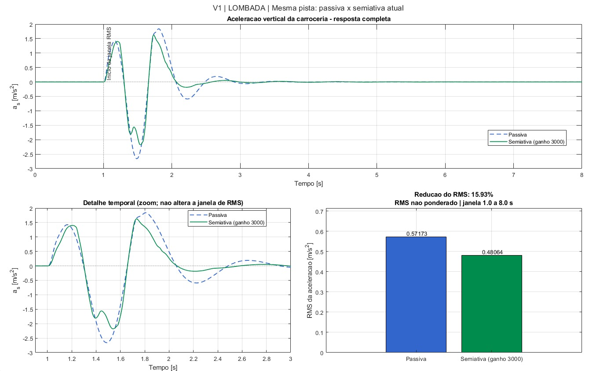
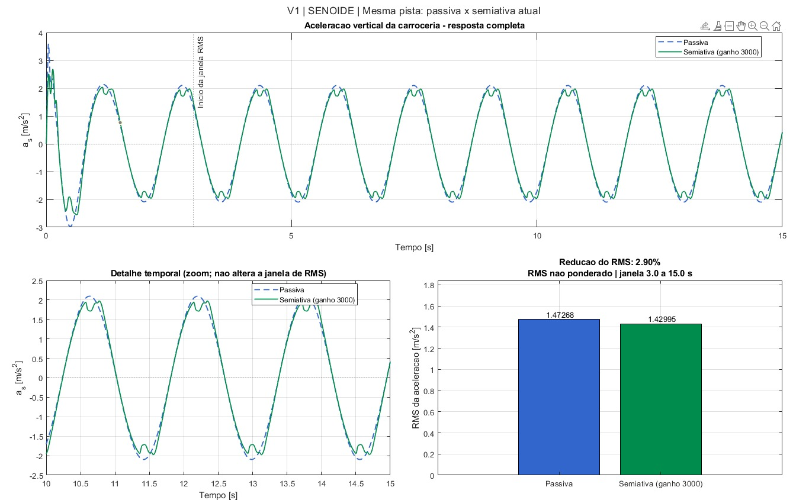
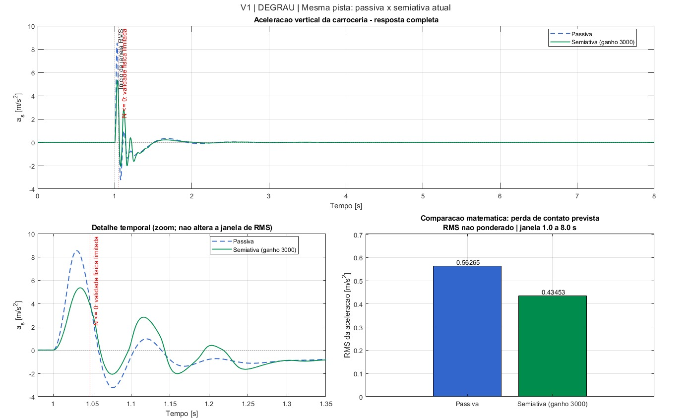

# v1 — primeira versão do modelo

Primeira versão da simulação no Simulink, com os **parâmetros da apresentação S1** (`parametros.m`). A ideia é ter a arquitetura completa rodando e comparar a semiativa com a passiva nas mesmas pistas.

## O que tem no modelo

- **Planta:** quarter-car de 2 GDL (espaço de estados), em coordenadas a partir do equilíbrio estático. A força normal no pneu é calculada separadamente: `N = (m_s + m_u)·g − k_t·(z_u − w)`.
- **Sensores:** dois acelerômetros (carroceria e roda) → A/D → integrador com fuga de 0,1 Hz (digital) para estimar as velocidades. Com `usar_sensores = 0`, o skyhook usa as velocidades exatas, para comparação.
- **Malha externa:** skyhook clássico, `c* = sat(c_sky·v_s/v_rel)` quando o amortecedor ajuda a frear a carroceria e `c* = c_mín` quando atrapalha. Depois a conversão `i_ref = (c* − c_mín)/K_ci`, limitada entre 0 e 1,5 A.
- **Malha interna:** PI de corrente discreto (Tustin, `T = 1 ms`), com saída limitada entre 0 e 12 V e anti-windup por *clamping*. A saída do PI fica constante entre amostras (ZOH).
- **Atuador:** bobina RL → válvula de 1ª ordem (`τ = 15 ms`), com `c` limitado entre 600 e 2400 N·s/m.
- **Passiva:** a mesma planta com `c = 1500 N·s/m` fixo, simulada junto para comparar.
- **Solver:** passo fixo `ode4` com `dt = 0,5 ms`.

## Decisões desta versão

- O limite de corrente e de amortecimento fica nos **blocos de saturação** (saída do PI e mapa da válvula), e não cortando os estados à força.
- **Sem limitador de taxa** no `c*`: ele não está no diagrama da S1 e, com a válvula de 15 ms, quase não teria efeito.
- O **degrau** de 3 cm virou uma **rampa de 20 ms**. Um degrau ideal faz a força no pneu ir para infinito.
- A pista ISO 8608 e a ponderação ISO 2631 ficam para as próximas versões.

## Como rodar

No MATLAB, com a pasta do repositório aberta:

```matlab
addpath('modelo')
montar_modelo          % só na primeira vez (ou se o montar_modelo.m mudar): cria modelo/suspensao_semiativa.slx
rodar_versao('v1')     % simula lombada, senoide e degrau e salva em versoes/v1/resultados/
```

Para mexer no modelo na mão: `run('versoes/v1/parametros.m')`, abrir o `.slx` e apertar *Run*. A pista usada é a do `pista_tipo` no fim do `parametros.m`.

## Resultados

Simulação rodada pelo Murilo no Simulink com `c_sky = 3000 N·s/m`. RMS da aceleração da carroceria, **sem ponderação**, contado a partir do início do evento (a janela está indicada em cada gráfico).

| Pista | Janela do RMS | RMS a_s passiva [m/s²] | RMS a_s semiativa [m/s²] | Melhora | Carga dinâmica no pneu, passiva / semi [N] |
|---|---|---|---|---|---|
| Lombada 5 cm | 1 a 8 s | 0,572 | 0,481 | 15,9 % | a preencher |
| Senoide 10 cm, 4 rad/s | 3 a 15 s | 1,473 | 1,430 | 2,9 % | a preencher |
| Degrau 3 cm (rampa 20 ms) | 1 a 8 s | 0,563 | 0,435 | 22,8 %* | a preencher |

\* No degrau a força normal no pneu chega a ≤ 0, ou seja, o pneu sairia do chão. Como o modelo não simula essa separação, esse número não vale como resultado.

### Lombada



A semiativa diminui principalmente o maior pico negativo (de −2,65 para −2,2 m/s²) e a oscilação que sobra depois da lombada (perto de 2,2 s), quando a carroceria balança sozinha. É aí que o skyhook mais ajuda. A melhora de 15,9 % ainda fica abaixo dos 30 % do Díaz-Choque (2021), mas o `c_sky` ainda não foi ajustado.

### Senoide



A senoide de 4 rad/s (≈ 0,64 Hz) fica abaixo da ressonância da carroceria (~1,2 Hz). Nessa faixa a mola é quem mais define o movimento e o amortecedor tem pouco efeito, por isso a melhora é pequena (2,9 %). As pequenas ondulações perto dos picos aparecem quando o skyhook troca entre macio e firme.

### Degrau



É a maior redução de RMS e a semiativa também corta o primeiro pico (de 8,5 para 5,3 m/s²). Por outro lado, logo depois a semiativa oscila mais que a passiva (perto de 1,12 s) e o modelo marca força normal ≤ 0 por volta de 1,05 s. Isso mostra o conflito conforto × aderência: melhorar a aceleração da carroceria não adianta se a roda perde contato com a pista. Por isso o resultado do degrau só vai ser comparado depois de olhar a carga no pneu.

## Observações

- O RMS ainda **não é ponderado** pela ISO 2631.
- Os valores da bobina e do PI (L, Kp, Ki) são hipóteses nossas, porque o catálogo não informa a indutância.
- Se a força normal ficar ≤ 0, o pneu sairia do chão. O modelo não simula essa separação e o `rodar_versao` mostra um aviso.
