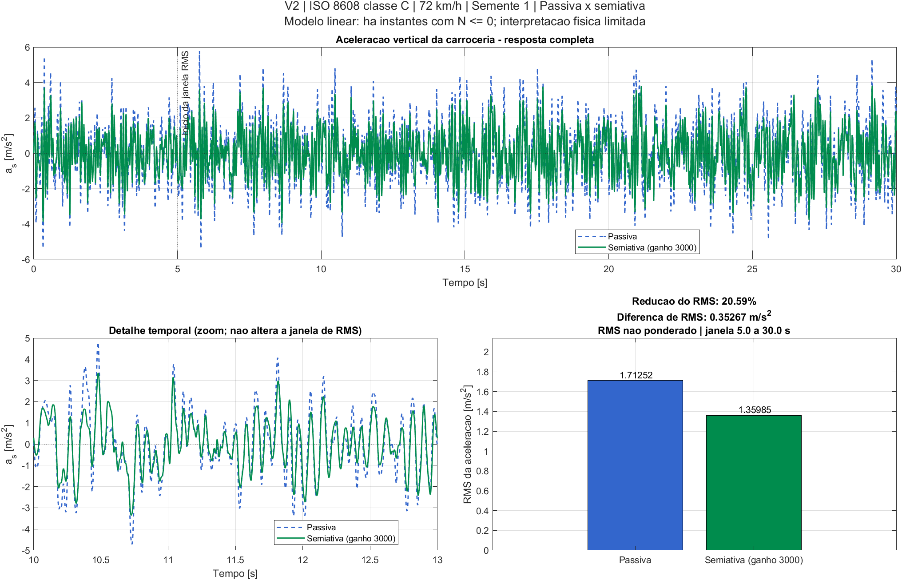

# v2 — pista irregular ISO 8608

Segunda versão da simulação. O modelo é **o mesmo da v1** (planta, sensores, skyhook, PI de corrente, bobina e válvula, com `c_sky = 3000 N·s/m`). A única mudança é a **pista**: em vez de lombada, senoide e degrau, o carro passa por uma pista irregular gerada pela norma ISO 8608, que representa melhor uma rua de verdade.

## O que mudou em relação à v1

- **Pista nova:** ISO 8608 **classe C** (estrada em estado médio) a **72 km/h** (20 m/s), em `modelo/gerar_pista.m`.
- **Cinco trechos diferentes** da mesma classe de pista (sementes 1 a 5), 30 s cada (600 m). Passiva e semiativa passam sempre pelo mesmo trecho.
- **Modelo próprio:** `versoes/v2/suspensao_semiativa_v2.slx`. O `.slx` da v1 em `modelo/` não foi alterado.
- **Parâmetros:** `parametros.m` carrega os da v1 e só acrescenta a pista. Nenhum valor da planta ou do controle mudou.

## Como a pista é gerada

A ISO 8608 não dá um perfil pronto: ela define o **espectro** da pista (quanta irregularidade existe em cada comprimento de onda). Para a classe C:

```
Gd(n) = 256·10⁻⁶ · (n / 0,1)⁻²   [m³]     n = frequência espacial [ciclos/m]
```

A pista é a **soma de 400 senoides**, com frequências espaçadas em escala log de 0,011 a 2,83 ciclos/m (0,22 a 56,6 Hz a 72 km/h). A amplitude de cada senoide sai da área do espectro na sua faixa, e a fase é sorteada com **semente fixa**. Por isso cada semente sempre gera o mesmo trecho. A altura inicial é subtraída para a pista começar em zero.

| Item | Valor |
|---|---|
| Classe / velocidade | C / 72 km/h |
| Senoides | 400, de 0,011 a 2,83 ciclos/m |
| Duração | 30 s (600 m) por trecho |
| Trechos | sementes 1, 2, 3, 4 e 5 (a 1 é a de referência nos gráficos) |
| Desvio padrão esperado | 15,2 mm |
| Janela das métricas | de 5 s a 30 s (os primeiros 5 s são a partida) |

**Conferência da pista:** o espectro medido nos cinco trechos tem inclinação −2,00 (alvo −2) e Gd(0,1) = 254·10⁻⁶ m³ (alvo 256·10⁻⁶). O desvio padrão de cada trecho varia entre 12,5 e 17,3 mm. É normal: num trecho de 600 m entram poucas ondas longas, e o 15,2 mm é a média esperada, não o valor de cada trecho. A figura `resultados/pista_e_PSD_v2.png` mostra o perfil e o espectro.

## Decisões desta versão

- **Cinco trechos em vez de um:** com um trecho só, o resultado poderia depender da sorte do sorteio. Com cinco dá para ver se a melhora se repete.
- **Não reescalar a pista** para forçar 15,2 mm em cada trecho, já que isso mudaria a classe.
- **Ignorar os primeiros 5 s** no RMS, porque o carro parte do repouso. A melhora quase não muda com a janela: 20,9 % (0–30 s), 20,6 % (5–30 s) e 20,2 % (10–30 s) na semente 1.
- **`c_sky` continua 3000**, igual à v1. O ajuste fica para a semana 3.

## Como rodar

No MATLAB, com a pasta do repositório aberta, abra `SIMULAR_V2.m` e clique em **Run**. Ele simula os cinco trechos, salva os resultados e abre o modelo. Também dá para rodar:

```matlab
[T,dados] = main('v2',false);   % cinco trechos, gráficos e validação
animar_suspensao(dados(1));     % animação passiva x semiativa (semente 1)
```

Para mexer no modelo na mão: dê duplo clique em `suspensao_semiativa_v2.slx` e aperte *Run*. Ele carrega os parâmetros da v2 e a pista da semente 1 sozinho.

Para refazer só o gráfico de aceleração (precisa ter rodado antes):

```matlab
plotar_comparacao_aceleracoes('v2',false);
```

## Resultados

Executado no **MATLAB R2024b**. RMS da aceleração da carroceria integrado de 5 s a 30 s, **sem ponderação ISO 2631**. Todos os números estão em `resultados/metricas_sementes.csv`.

| Trecho (semente) | RMS a_s passiva [m/s²] | RMS a_s semiativa [m/s²] | Melhora |
|---|---|---|---|
| 1 | 1,7125 | 1,3598 | 20,59 % |
| 2 | 1,6787 | 1,3624 | 18,84 % |
| 3 | 1,7082 | 1,3896 | 18,65 % |
| 4 | 1,7002 | 1,3560 | 20,25 % |
| 5 | 1,6510 | 1,3195 | 20,08 % |
| **Média** | **1,6901** | **1,3574** | **19,68 %** (± 0,88) |

A melhora fica perto de 20 % nos cinco trechos, então ela não depende do trecho sorteado.



Na resposta completa (em cima), a semiativa (verde) fica quase sempre por dentro da passiva (azul tracejado), principalmente nos picos. No trecho de referência, o maior pico cai de 5,8 para 4,0 m/s². No zoom entre 10 e 13 s, as duas curvas sobem e descem juntas, porque quem manda no movimento lento é a pista. A diferença está na altura dos picos: quando a carroceria começa a balançar, o skyhook endurece o amortecedor e corta o pico. É o mesmo efeito da lombada na v1, só que agora repetido o tempo todo.

A melhora de ~20 % é maior que a da lombada da v1 (15,9 %), porque a pista ISO tem muita energia perto da ressonância da carroceria (~1,2 Hz), onde o skyhook mais funciona. Ela ainda fica abaixo dos 41 % do Díaz-Choque (2021) na pista ISO. Duas explicações prováveis: o `c_sky` ainda não foi ajustado, e a nossa válvula só vai de 600 a 2400 N·s/m.

**Vídeo:** [animação passiva x semiativa](resultados/videos/v2_iso8608_classeC_72kmh.mp4) (semente 1, câmera lenta 0,5x, deslocamentos ampliados 4x).

### Conferência dos números

Os resultados foram conferidos de duas formas, fora do Simulink:

- **Cálculo analítico da passiva** (resposta em frequência × espectro da pista): RMS de 1,68 m/s², contra 1,69 m/s² na média do Simulink.
- **Gabarito em Python** (mesmas equações e a mesma pista, ponto a ponto): a passiva deu igual ao Simulink em todos os trechos. A semiativa deu 19,5 % de melhora média contra 19,7 %. A diferença de 0,2 ponto é do mesmo tamanho da que já existia na v1 e não muda nenhuma conclusão.

O próprio script da v2 também testa as equações, a passividade do amortecedor e a convergência numérica: com o passo pela metade, o RMS muda menos de 0,01 % (`resultados/validacao.csv` e `resultados/convergencia_numerica.csv`).

## Limitações

- **Aderência:** a melhora no conforto teve um custo. A carga dinâmica no pneu aumentou **23 %** (802 → 988 N RMS, média dos cinco trechos), e em todos os trechos a semiativa tem instantes com força normal ≤ 0, ou seja, o pneu sairia do chão. Somando, são de 0,05 a 0,10 s em 30 s. A passiva também passa por isso nos trechos 4 e 5, por bem menos tempo. O efeito não vem da partida: continua aparecendo de 5 s a 30 s. Como no degrau da v1, o modelo de pneu não simula a roda saindo do chão, então os números perto desses instantes não valem fisicamente. Esse é o conflito conforto × aderência do skyhook puro, e ele vai ser tratado na **escolha do `c_sky` (semana 3)**, que define a **v3**. Detalhes em `resultados/diagnostico_contato.csv`.
- **Corrente:** a corrente da bobina chegou a 1,58 A, acima do limite de 1,5 A da referência. O amortecimento continua limitado a 2400 N·s/m, então a força não muda, mas é um ponto a citar sobre o atuador.
- O RMS **não é ponderado** pela ISO 2631. Mede vibração, não conforto percebido.
- O resultado vale para essa classe de pista e essa velocidade. Outras velocidades ou pistas não foram testadas.

## Arquivos

| Arquivo | O que é |
|---|---|
| `parametros.m` | parâmetros da v1 + pista ISO |
| `suspensao_semiativa_v2.slx` | modelo do Simulink da v2 |
| `resultados/comparacao_aceleracoes/aceleracao_iso8608.png` | gráfico principal (formato da v1) |
| `resultados/metricas_sementes.csv` | métricas dos cinco trechos (`metricas.csv` = só o trecho 1) |
| `resultados/resumo_cinco_sementes.csv` | média e desvio entre os trechos |
| `resultados/comparacao_v2.png` | painel com aceleração, força no pneu e curso |
| `resultados/controle_v2.png` | corrente, tensão e amortecimento |
| `resultados/pista_e_PSD_v2.png`, `PSD_pista.csv`, `conferencia_classe_C.csv` | conferência da pista |
| `resultados/perfil_iso8608_semente1.csv` | perfil da pista do trecho 1 |
| `resultados/diagnostico_contato.csv` | quando e por quanto tempo N ≤ 0 |
| `resultados/validacao.csv`, `convergencia_numerica.csv` | testes do modelo |
| `resultados/diagrama_v2.png` | diagrama do modelo |
| `resultados/videos/` | animação em MP4 |

Scripts usados (pastas da raiz): `modelo/executar_v2.m` (roda tudo), `modelo/gerar_pista.m`, `visualizacao/plotar_v2.m`, `visualizacao/exportar_video_v2.m`, `testes/validar_v2.m`. O `modelo/varrer_ganhos_v2.m` já deixa pronta a varredura de `c_sky` da semana 3, sem mudar nada da v2.

Os arquivos `.mat` (sinais completos) e `.fig` são gerados ao rodar e não vão para o Git.

## Referências usadas

- ISO 8608:2016 — perfis de pista.
- Resumo da pista classe C a 72 km/h: [`docs/Resumo_ISO8608_ClasseC_72kmh.pdf`](../../docs/Resumo_ISO8608_ClasseC_72kmh.pdf).
- DÍAZ-CHOQUE et al. (2021), seção 6.1 — skyhook em pista ISO. DOI: [10.1155/2021/8084343](https://doi.org/10.1155/2021/8084343).
- AGOSTINACCHIO, M.; CIAMPA, D.; OLITA, S. (2014) — geração de perfis ISO 8608. DOI: [10.1007/s12544-013-0127-8](https://doi.org/10.1007/s12544-013-0127-8).
